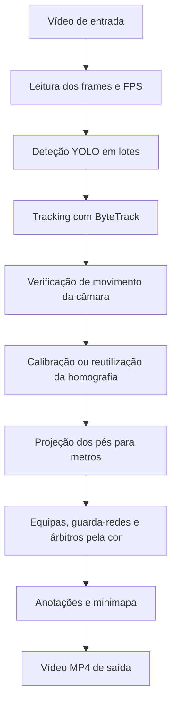

# FutTrack — Tracking e projeção de jogadores de futebol

O **FutTrack** é um projeto de visão computacional em Python que transforma vídeo de futebol em posições de jogadores num mapa bidimensional do campo. Combina deteção com YOLO, acompanhamento temporal com ByteTrack e calibração por homografia para converter coordenadas da imagem em coordenadas em metros.

O resultado é um vídeo anotado com IDs de tracking e um minimapa. Um segundo percurso de execução exporta os dados para JSON, permitindo analisá-los sem voltar a executar os modelos.

O projeto explora a ligação entre **deep learning, tracking de múltiplos objetos e geometria de visão computacional**, aplicada à análise desportiva. Está numa fase de desenvolvimento e validação visual.

## Funcionalidades implementadas

- Deteção de pessoas e bola no módulo `Tracker`; jogadores, guarda-redes e árbitros são fundidos numa só classe antes do tracking.
- Tracking de todas as pessoas com ByteTrack.
- Classificação em equipa A, equipa B, guarda-redes e árbitros pela cor da camisola e pela posição (`TeamAssigner`).
- Deteção de 32 pontos de referência do campo e estimação de homografia com RANSAC.
- Projeção dos pés dos jogadores para coordenadas em metros.
- Verificação de movimento da câmara para decidir quando recalibrar no `main.py`.
- Estabilização da homografia frame a frame e suavização das trajetórias, com velocidade de cada pessoa e posições estimadas quando sai de imagem.
- Reidentificação de jogadores que desaparecem e voltam (`global_id`).
- Limpeza de falsos positivos e interpolação da trajetória da bola.
- Posse de bola por frame (equipa 0, equipa 1 ou disputada), com painel de percentagens no vídeo.
- Sobreposição de um minimapa com os IDs apresentados no vídeo.
- Execução alternativa por fases, com exportação JSON e medição de tempos.

## Tecnologias

| Tecnologia | Papel no projeto |
| --- | --- |
| Python | Organização e execução do processamento |
| Ultralytics / YOLO | Deteção de objetos e pontos de referência do campo |
| Supervision / ByteTrack | Associação de deteções entre frames e atribuição de IDs |
| OpenCV | Vídeo, fluxo ótico, homografia e desenho |
| NumPy | Operações matriciais e transformação de coordenadas |
| PyTorch | Execução dos modelos e sincronização CUDA na medição de tempos do script por fases |

## Como funciona o programa

O fluxo principal de `main.py` segue estas etapas:



### 1. Leitura do vídeo

O `main.py` processa o vídeo **em streaming**, sem nunca o ter todo em memória (um frame de 1920×1080 ocupa cerca de 6,2 MB, por isso 5 minutos a 25 fps seriam mais de 50 GB). Lê o vídeo duas vezes, com `iter_batches` e `iter_frames`, de `utils/video_utils.py`:

1. **Análise:** lotes de 32 frames → deteção e tracking (o mesmo ByteTrack mantém o estado entre lotes) → homografia → recolha das cores das camisolas (`TeamAssigner.add_frame`). No fim ficam apenas as `tracks` e as matrizes de homografia, e correm as etapas que precisam do vídeo todo: equipas, ReID, limpeza e interpolação da bola e posse.
2. **Desenho:** volta a ler o vídeo, desenha cada frame (`Tracker.draw_frame`, minimapa e painel de posse) e escreve-o logo no ficheiro de saída.

No vídeo de teste, o pico de memória passou de cerca de 9 GB para 3,5 GB. Depois de carregar os modelos (≈1,9 GB), cresce apenas cerca de 0,2 GB por cada 750 frames (as `tracks`), o que dá uns 4–5 GB para 5 minutos. Os FPS são usados na exportação para preservar a cadência de reprodução. `read_video` continua disponível para scripts que precisem dos frames em memória.

### 2. Deteção dos objetos

O `Tracker`, em `trackers/tracker.py`, carrega `modelo/player.pt` e executa a deteção em lotes de **32 frames**, com um limiar de confiança de **0,1**.

Cada deteção contém uma classe e uma bounding box no formato `[x1, y1, x2, y2]`. Os resultados são convertidos para o formato da biblioteca Supervision. Antes do tracking, as classes `player`, `goalkeeper` e `referee` são fundidas numa só classe de pessoa. As classes do modelo atual ainda não são fiáveis, e a fusão evita que um ID mude quando a classe oscila entre frames. A classe original fica guardada em `yolo_class`, apenas como pista. Como o NMS do YOLO é feito por classe, a mesma pessoa pode vir em duas caixas (por exemplo `player` e `goalkeeper`); depois da fusão aplica-se um segundo NMS (IoU 0,7) para eliminar esses duplicados.

### 3. Tracking entre frames

O ByteTrack associa as deteções ao longo do vídeo e atribui IDs a todas as pessoas. O objetivo é manter uma referência temporal ao mesmo objeto enquanto este permanece acompanhado. O tracker usa os FPS do vídeo e lembra-se de uma pessoa perdida durante 90 frames (`lost_track_buffer`, 3,6 s a 25 fps). Desaparecimentos mais longos são tratados pelo ReID (secção 6.2).

Durante a análise do vídeo, os resultados são organizados por categoria, frame e ID (o formato natural do tracking, que vê um frame de cada vez). Depois do ReID são convertidos para o `Game` (secção 6.5):

```text
tracks
├── players  → lista de frames → ID → dados do jogador
├── referees → lista de frames → ID → dados do árbitro
└── ball     → lista de frames → deteção da bola
```

A bola é guardada a partir das deteções com a chave fixa `1`; essa chave não representa uma identidade mantida pelo ByteTrack. Fica a deteção mais confiante do frame, com a confiança e a lista de todas as candidatas (para a limpeza da secção 6.3). No desenho do `main.py`, os jogadores recebem elipses e IDs com a cor da equipa, os árbitros recebem elipses amarelas e a bola é assinalada com um triângulo (verde se foi detetada, verde-claro se foi interpolada). O jogador com a bola recebe um triângulo vermelho. A lista `referees` é preenchida pelo `TeamAssigner` (ver secção seguinte).

### 4. Verificação do movimento da câmara

Uma homografia depende da perspetiva da câmara. Se houver deslocação ou zoom, pode ser necessário recalibrar a transformação.

No `main.py`, `camera_moved` compara o frame atual com o frame de referência da última calibração bem-sucedida:

1. Reduz a imagem, quando necessário, para uma largura de 640 píxeis e converte-a para tons de cinzento.
2. Seleciona pontos visuais com `goodFeaturesToTrack`.
3. Acompanha os pontos com fluxo ótico de Lucas–Kanade.
4. Estima uma transformação afim parcial com RANSAC para representar o movimento global.
5. Verifica a quantidade e a distribuição dos pontos consistentes e mede a deslocação em nove locais da imagem.

Se a deslocação máxima atingir **0,35 píxeis na imagem preparada**, a função indica movimento. Uma estimação pouco fiável também desencadeia a tentativa de recalibração.

Quando não é detetado movimento e existe uma matriz válida, o programa reutiliza a homografia. Se a calibração falhar, a matriz fica indisponível e a tentativa é repetida no frame seguinte.

### 5. Calibração geométrica do campo

`Homography`, em `homografia/homografia.py`, usa `modelo/pitch.pt` para detetar **32 keypoints**, associados às linhas e à geometria do campo.

Cada ponto da imagem é associado a uma posição conhecida em `FootballPitch`. O índice `0` do modelo corresponde ao ID `1` do campo, até ao índice `31`, correspondente ao ID `32`. A ordem dos pontos no modelo tem de coincidir com esta definição.

A calibração:

- Filtra pontos com confiança inferior a **0,5**, coordenadas inválidas ou posição `(0, 0)`.
- Exige pelo menos **quatro correspondências válidas**, numa configuração não degenerada.
- Usa RANSAC para rejeitar correspondências inconsistentes, com um limiar de reprojeção de **5 píxeis**.
- Estima primeiro a transformação campo → imagem, para medir o erro em píxeis, e inverte-a para obter imagem → campo.

O campo de referência está definido como **120 × 70 metros**. Os valores originais são armazenados em centímetros e convertidos para metros por `get_keypoints()`. As dimensões e posições de referência devem ser ajustadas ao campo e às anotações usados.

### 6. Projeção dos jogadores para metros

Para cada bounding box, o programa usa o **centro da aresta inferior** como aproximação da posição dos pés:

```text
feet_px = [(x1 + x2) / 2, y2]
```

Esse ponto é transformado pela matriz de homografia `H`:

```text
[a, b, c]ᵀ = H × [u, v, 1]ᵀ
x = a / c
y = b / c
```

O resultado é uma posição `(x, y)` em metros, com origem no ponto de referência `1` do campo. Dentro dos limites definidos, `x` varia de 0 a 120 e `y` de 0 a 70.

`update_tracks` acrescenta `feet_px` e `position_m` aos objetos recebidos. Sem uma matriz válida, `position_m` fica a `None`. O minimapa apresenta jogadores, guarda-redes e árbitros com as respetivas cores.

### 6.1. Equipas, guarda-redes e árbitros

`TeamAssigner`, em `team_assigner/team_assigner.py`, corre depois da homografia e não depende das classes do YOLO:

1. Em cada 5.º frame, recorta a camisola (zona central da metade superior da bounding box), ignorando caixas pequenas ou sobrepostas.
2. Remove os píxeis do relvado. A cor da relva é estimada **em cada frame** e comparada em tom, saturação e brilho, porque há equipamentos (por exemplo verde-lima) com o mesmo tom da relva.
3. Calcula a cor mediana em LAB, dando menos peso à luminosidade para tolerar sombras.
4. Agrupa as cores das tracks com KMeans (k=4). As duas equipas são os dois grupos com mais amostras e cores distintas; os centros são depois afinados sem os valores afastados.
5. Cada track recebe a equipa mais votada nas suas amostras. Se a maioria estiver longe das duas equipas, a track é um "outro".
6. Um "outro" que é quase sempre a pessoa mais recuada do campo (atrás de pelo menos 90 % dos jogadores de campo em 60 % dos frames, ou em 30 % se o YOLO o marcar como `goalkeeper`) e não está junto à linha lateral é guarda-redes. Não se usa uma distância fixa à baliza, porque o guarda-redes sobe quando a equipa ataca. A equipa é a que está, em média, mais perto dele frame a frame. Os restantes são árbitros e passam para `tracks["referees"]`.

Cada jogador fica com `team` (0 ou 1), `role` (`player`, `goalkeeper` ou `referee`) e `team_color` (a cor real da camisola, em BGR). A numeração das equipas é estável: segue o canal de cor (L, a ou b) em que as duas camisolas mais diferem.

### 6.2. Reidentificação (ReID)

Quando um jogador desaparece (oclusão ou saída de imagem) e volta, o ByteTrack dá-lhe um ID novo. `ReIdentifier`, em `reid/reid.py`, corre depois do `TeamAssigner` e junta essas tracks em cadeias, cada uma com um `global_id`:

1. Constrói uma vista por track (`reid/tracklets.py`): primeiro e último frame, posições inicial e final em metros (mediana de 5 amostras) e a velocidade de saída (regressão linear nas últimas 10 posições, limitada a 8 m/s).
2. Um par "A acaba → B começa" só é possível se as tracks forem da **mesma equipa e do mesmo papel**, se **B começar depois de A** (nunca coexistem) até 10 s depois, e se a **distância for fisicamente possível**: `|início(B) − previsão(A)| ≤ 2 m + 8 m/s × intervalo`. A previsão usa a velocidade de saída durante, no máximo, 1 s. Por usar metros, funciona com a câmara em movimento.
3. Guarda-redes: sem limite de tempo, porque só há um por equipa.
4. Sem homografia, só se aceitam intervalos até 1 s, com a distância em píxeis.
5. As ligações são escolhidas em conjunto com o algoritmo húngaro (`scipy.optimize.linear_sum_assignment`). Uma ligação é rejeitada se houver outro candidato quase tão bom: é preferível um ID novo a trocar dois jogadores.

O vídeo e o minimapa mostram o `global_id`; o ID do ByteTrack mantém-se como chave em `tracks`. No fim, o terminal apresenta um resumo por grupo (tracks, identidades e ligações). No vídeo de teste, o resultado é de 10 + 10 jogadores de campo, 1 + 1 guarda-redes e 3 árbitros.

Os pés aproximam um ponto no plano do relvado, condição necessária para esta transformação. O centro do corpo ou uma bola no ar não pertencem a esse plano, pelo que a sua projeção não representa corretamente a posição no solo.

### 6.3. Bola: limpeza, interpolação e posse

`BallTracker`, em `ball/ball_tracker.py`:

1. **Limpeza (antes da homografia, só em píxeis).** A trajetória é dividida em segmentos coerentes (deslocação até `30 px + 70 px × frames`). Segmentos de até 3 frames incoerentes com os vizinhos dos dois lados são falsos positivos e são removidos. Nos frames que ficam sem bola, aceita-se outra candidata do detetor se for coerente com os vizinhos. No vídeo de teste: 5 falsos positivos removidos (saltos de até 886 px num frame) e 2 recuperados.
2. **Interpolação (depois da homografia).** Nas lacunas até 50 frames (2 s), assume-se que a bola se moveu a velocidade constante em linha reta. Se houver homografia em toda a lacuna, interpola-se em metros no campo e projeta-se para a imagem de cada frame, o que é correto mesmo com a câmara em movimento; senão, interpola-se em píxeis. Não se extrapola antes da primeira nem depois da última deteção. As posições criadas têm `interpolated=True` e `gap_frames`. No vídeo de teste, a bola passa de 592 para 750 frames.

`PossessionAssigner`, em `ball/possession.py`, usa a distância dos pés de cada jogador à bola (em metros; sem homografia, em píxeis convertidos pela altura do jogador):

- ninguém a menos de **2,5 m** → bola livre (passe ou remate): **mantém a posse anterior**;
- jogadores das duas equipas dentro do raio, com distâncias a menos de **1 m** uma da outra → **disputada**;
- caso contrário → equipa do jogador mais próximo, que fica com `has_ball=True`.

Uma mudança de posse só é aceite se durar **5 frames seguidos**. As posições interpoladas em lacunas com mais de **8 frames** não mudam a posse: a bola falha sobretudo quando está tapada nos pés de um jogador, e aí o movimento real (receção, condução, passe) não é uma linha reta. A posição interpolada serve para desenhar, mas pode passar a 3–4 m de quem tem a bola.

O vídeo mostra um painel com a posse atual e as percentagens acumuladas; o terminal mostra as percentagens finais. O raio de 2,5 m foi escolhido no vídeo de teste: com 1,5 m, a bola estava "livre" em 72 % dos frames (o jogador mais próximo está, em mediana, a 2,2 m, porque na condução a bola vai à frente do pé e a homografia tem erro).

### 6.4. Estabilização da homografia e suavização das posições

As posições brutas são demasiado ruidosas para calcular velocidades: no vídeo de teste, 14 % das velocidades frame a frame passavam de 11 m/s, com máximos de 419 m/s. Há dois tipos de erro, tratados em separado (módulo `positions/`).

**1. Erro da homografia (comum a todos), em `positions/stabilizer.py`.** As posições estão em metros no campo, por isso o movimento da câmara não as devia mudar; quando todos os jogadores de um frame "saltam" juntos, o erro é da matriz desse frame (a câmara mexe-se quase sempre e a homografia é recalculada em 582 dos 750 frames). Para cada frame, estima-se com RANSAC a transformação de semelhança que leva as posições de todos os jogadores para uma referência robusta (a mediana da trajetória de cada um numa janela de ±12 e depois ±6 frames). Essa correção é aplicada à própria matriz, e as posições de jogadores e bola são recalculadas. Corre logo depois da análise, antes das equipas e do ReID. No vídeo de teste, o deslocamento comum no percentil 99 passou de 79 m/s para 21 m/s, com 142 frames corrigidos em mais de 0,5 m.

**2. Erros de cada pessoa, em `positions/smoother.py`.** Corre depois do ReID, por `global_id`:

- descarta as caixas cortadas pela borda da imagem (o "centro dos pés" desloca-se), exceto se uma track só tiver caixas na borda;
- descarta saltos isolados com um filtro de Hampel (mais longe da mediana da janela de ±7 frames do que 3 desvios robustos ou 1 m);
- preenche em linha reta os pontos descartados e as ausências entre tracks ligadas pelo ReID;
- suaviza com um filtro Savitzky–Golay (janela de 1 s, grau 2), que dá também a velocidade.

Cada pessoa medida fica com `position_smooth`, `speed_ms`, `speed_reliable` (falso na meia janela inicial e final de cada trajetória, onde a derivada é extrapolada) e `position_quality` (`measured`, `outlier` ou `border`). As posições nas ausências ficam em `tracks["estimated"][frame][global_id]`, com `estimated=True`. São desenhadas no minimapa como círculos vazios, mas **não devem entrar nas estatísticas físicas**: a linha reta subestima a distância e dá uma velocidade média artificial.

Resultado no vídeo de teste: velocidade mediana de 2,5 m/s, percentil 99 de 8,3 m/s e máximo fiável de 10,9 m/s. Limitação: a linha reta só é razoável em ausências curtas; para ausências longas, o plano é deslocar o jogador com o bloco da equipa (posição relativa ao centro da equipa).

### 6.5. Estrutura dos dados: `Game` e `PlayerTrack`

Depois do ReID, o `main.py` converte o formato por frame (`tracks["players"]` e `tracks["referees"]`) numa estrutura organizada **por pessoa**, no módulo `game/`. A partir daí, a suavização, a posse, o desenho e a exportação usam só esta estrutura, e os dicionários por frame são apagados.

**`PlayerTrack` (`game/player_track.py`): a ficha de uma pessoa** (jogador, guarda-redes ou árbitro). O que é fixo fica guardado uma só vez (`global_id`, `team`, `role`, `color`). O que muda fica em arrays numpy do mesmo tamanho, um elemento por frame em que a pessoa existe:

| Array | Conteúdo |
| --- | --- |
| `frames` | Números dos frames |
| `x`, `y` | Posição suavizada (m) |
| `x_raw`, `y_raw` | Posição medida (m); `NaN` sem medição |
| `speed`, `speed_reliable` | Velocidade (m/s) e se é fiável |
| `quality` | `measured`, `outlier`, `border`, `estimated` ou `uncalibrated` |
| `bbox`, `track_ids` | Caixa em píxeis e ID do ByteTrack (vazios quando estimada) |

Os frames em que a pessoa esteve fora de imagem fazem parte da mesma ficha, com `quality = "estimated"`.

**`Game` (`game/game.py`): o jogo.** Guarda as fichas (`players`, por `global_id`) e os dados do jogo por frame que não pertencem a nenhuma pessoa: `possession` (equipa com a posse) e `ball_holder` (`global_id` de quem tem a bola). Não há informação repetida: "este jogador tem a bola?" consulta-se em `ball_holder`, e a equipa de cada jogador está só na ficha dele.

- `game.players[7].x` dá a trajetória completa do jogador 7;
- `game.positions_at(300)` dá a lista das pessoas no frame 300 (usada pela posse e pelo desenho);
- `game.to_csv(path)` exporta uma linha por pessoa e por frame. O `main.py` grava `output_videos/posicoes.csv`, que pode ser aberto no Excel.

A bola continua organizada por frame (`tracks["ball"]`).

### 7. Anotações e minimapa

`PitchMinimap`, em `homografia/minimap.py`, desenha o campo no canto inferior direito do vídeo e apresenta as posições projetadas com os respetivos IDs.

O painel permite inspecionar a coerência da projeção: um jogador junto à linha de meio-campo deve aparecer perto dessa linha no mapa.

- `Projetados` indica o número de posições entregues ao minimapa, incluindo as exteriores ao campo.
- `Fora` conta posições inválidas ou exteriores; esses pontos não são desenhados nem ajustados artificialmente às linhas.
- `sem calibracao` indica que não existe uma homografia disponível para esse frame.

As cores dos pontos correspondem às equipas; os árbitros aparecem a amarelo.

### 8. Exportação do vídeo

O programa escreve cada frame anotado em `output_videos/outputvideo.mp4` assim que é desenhado, usando o codec `mp4v` e os FPS obtidos na leitura. O resultado reúne o vídeo original, as anotações dos objetos e o minimapa.

## Execução por fases e exportação JSON

O script `yolo_inference.py` disponibiliza um segundo percurso:

| Fase | Operação | Resultado |
| --- | --- | --- |
| 1. Tracking | Percorre o vídeo em lotes de 32 frames, mantendo a mesma instância do tracker | IDs e bounding boxes dos jogadores por frame |
| 2. Homografia e projeção | Reabre o vídeo e calcula uma homografia em cada frame | Posições dos pés, posições em metros e estado da calibração |
| 3. Exportação | Guarda os resultados e metadados | Ficheiro JSON |
| 4. Renderização | Reabre o vídeo e desenha a partir dos dados calculados, sem executar os modelos | Vídeo com caixas, IDs, pés e minimapa |

Neste percurso, a calibração é feita **em todos os frames**, sem usar `camera_moved`. As imagens são lidas em lotes ou uma a uma; apenas os resultados ficam em memória durante todo o processamento. A lista de resultados continua a crescer com a duração do vídeo.

O JSON inclui `source`, `fps`, `pitch_m` e uma lista `frames`. Cada frame contém:

| Campo | Significado |
| --- | --- |
| `frame_index` | Índice do frame, a começar em zero |
| `players` | Jogadores com `track_id`, `bbox`, `feet_px` e `position_m` |
| `homography` | Matriz 3 × 3 de transformação, ou `null` |
| `inlier_ids` | IDs dos pontos de referência aceites pelo RANSAC |
| `calibration_error` | Mensagem de falha da calibração, ou `null` |

Quando não é possível projetar um jogador, `position_m` fica a `null`. O terminal apresenta a duração e a hora de conclusão de cada fase em UTC, além do número de frames com homografia calculada.

## Instalação e utilização

### Preparar o ambiente

É necessário um ambiente Python com `venv` e `pip`. A instalação abaixo inclui as dependências usadas pelo código; o repositório ainda não fixa as respetivas versões.

```powershell
python -m venv .venv
.\.venv\Scripts\Activate.ps1
python -m pip install --upgrade pip
python -m pip install ultralytics "supervision<0.27" opencv-python numpy scipy torch
```

### Preparar os ficheiros

Executar os comandos na raiz do projeto, com estes ficheiros disponíveis:

```text
modelo/player.pt             # Modelo de deteção de objetos
modelo/pitch.pt              # Modelo dos 32 keypoints do campo
input_videos/inputvideo.mp4   # Vídeo a analisar
```

O modelo de objetos deve disponibilizar as classes `player`, `goalkeeper`, `referee` e `ball`. O modelo do campo deve respeitar a ordem dos keypoints definida em `FootballPitch`.

### Executar o fluxo principal

```powershell
New-Item -ItemType Directory -Force output_videos
python main.py
```

O `main.py` usa caminhos definidos no próprio ficheiro. Para mudar o vídeo ou o destino, editar `video_path` e `output_path`.

**Saída:** `output_videos/outputvideo.mp4`.

### Executar o fluxo por fases

```powershell
python yolo_inference.py
```

**Saídas predefinidas:** `output_videos/pitch_homography.mp4` e `output_videos/pitch_homography.json`.

É possível escolher os caminhos pela linha de comandos:

```powershell
python yolo_inference.py --source input_videos/jogo.mp4 --output output_videos/jogo_analisado.mp4 --positions output_videos/jogo_posicoes.json --model modelo/pitch.pt --player-model modelo/player.pt
```

As pastas de saída são criadas automaticamente neste script. Aguardar pelo fim do processamento antes de abrir o vídeo resultante.

## Estrutura do projeto

```text
FutTrack/
├── main.py                    # Fluxo principal com verificação de movimento
├── yolo_inference.py          # Fluxo por fases, CLI e exportação JSON
├── trackers/
│   └── tracker.py             # Deteção, ByteTrack e anotações dos objetos
├── homografia/
│   ├── homografia.py          # Calibração e transformação de coordenadas
│   ├── football_pitch.py      # Geometria e 32 pontos de referência do campo
│   └── minimap.py             # Desenho do campo e posições projetadas
├── team_assigner/
│   └── team_assigner.py       # Equipas, guarda-redes e árbitros pela cor
├── reid/
│   ├── tracklets.py           # Vista por track (início, fim, posições, velocidade)
│   ├── reid.py                # Ligação de tracks da mesma pessoa (global_id)
│   └── diagnostics.py         # Resumo de tracks e identidades por grupo
├── ball/
│   ├── ball_tracker.py        # Limpeza e interpolação da trajetória da bola
│   ├── possession.py          # Posse de bola por frame
│   └── drawing.py             # Painel de posse no vídeo
├── game/
│   ├── player_track.py        # Ficha de uma pessoa (arrays por frame)
│   └── game.py                # Fichas + posse por frame; vista por frame; CSV
├── positions/
│   ├── stabilizer.py          # Correção da homografia frame a frame
│   └── smoother.py            # Saltos, suavização, velocidade e ausências
├── tests/
│   ├── test_reid.py           # Testes sintéticos do ReID (python -m pytest tests/)
│   ├── test_ball.py           # Testes sintéticos da bola e da posse
│   └── test_positions.py      # Testes da estabilização e da suavização
├── utils/
│   ├── video_utils.py         # Leitura, escrita e deteção de movimento
│   └── bbox_utils.py          # Operações auxiliares sobre bounding boxes
├── modelo/                    # Pesos dos modelos de inferência
├── training/                  # Notebook, dataset e artefactos de treino
├── input_videos/              # Vídeos de entrada
└── output_videos/             # Vídeos e dados gerados
```

## Treino e dados

A pasta `training/` contém o notebook `train.ipynb` e artefactos de experiências de deteção. A configuração em `training/runs/detect/train-7/args.yaml` regista uma experiência baseada em **YOLO11m**, configurada para **100 épocas**, imagens de **640 píxeis** e batch de **8**. Estes valores descrevem a configuração da experiência; não demonstram, por si só, o desempenho dos modelos usados em inferência.

O dataset incluído identifica como origem o Football Players Detection, no Roboflow, e indica a licença **CC BY 4.0**. A referência original e os dados de atribuição estão em [README.dataset.txt](training/football-players-detection-1/README.dataset.txt).

## Decisões técnicas e competências demonstradas

- **Separação de responsabilidades:** deteção e tracking, geometria, vídeo e visualização estão organizados em módulos próprios.
- **Associação temporal:** a continuidade do estado do ByteTrack permite acompanhar objetos entre frames e entre lotes no script por fases.
- **Geometria robusta:** filtragem de keypoints, RANSAC e verificação de matrizes degeneradas reduzem a utilização de calibrações inválidas.
- **Tratamento explícito de falhas:** posições indisponíveis são representadas por `None`/`null`, distinguindo ausência de calibração de uma posição válida.
- **Dados separados da visualização:** a exportação JSON permite reutilizar resultados em análises posteriores.
- **Compromissos de processamento:** os dois percursos exploram a reutilização de calibração e a leitura em várias passagens com menor retenção de imagens em memória.

## Limitações e próximos passos

O `global_id` representa uma pessoa ao longo do vídeo, não a sua identidade real (nome ou número). O ReID usa apenas equipa, papel, tempo e posição: falha quando um jogador fica mais de 10 s fora de imagem, em cortes de câmara (repetições, grandes planos) e quando vários colegas desaparecem juntos no mesmo sítio (casos que deixa por ligar). Os próximos passos são acrescentar aparência (um modelo de ReID como o OSNet) e o número da camisola.

A precisão depende da deteção dos pés, da qualidade e distribuição dos keypoints e da correspondência entre o campo real e o modelo geométrico. A inspeção do minimapa ajuda a identificar erros visuais, mas não substitui uma avaliação quantitativa. Este README não apresenta resultados validados de precisão em metros, qualidade de tracking ou velocidade de processamento.

A classificação por equipa usa a cor da camisola e falha quando um guarda-redes ou árbitro veste uma cor parecida com a de uma equipa, ou quando o ByteTrack troca IDs entre jogadores de equipas diferentes. O fluxo por fases (`yolo_inference.py`) ainda não usa o `TeamAssigner`.

O sistema atual também não implementa reconhecimento de jogadores, cálculo de velocidade, distância percorrida, posse de bola ou mapas de calor. Estes são possíveis desenvolvimentos a partir das posições exportadas, após validação da sua qualidade.

Os próximos passos incluem fixar versões das dependências, avaliar deteção, tracking e projeção com dados anotados e melhorar a estabilidade temporal da calibração.
