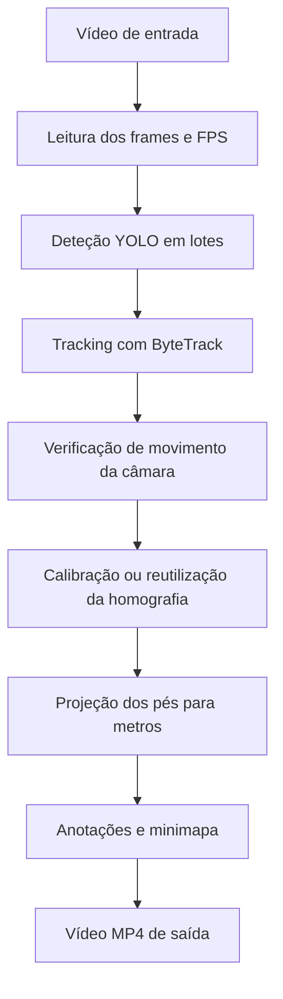

# FutTrack — Tracking e projeção de jogadores de futebol

O **FutTrack** é um projeto de visão computacional em Python que transforma vídeo de futebol em posições de jogadores num mapa bidimensional do campo. Combina deteção com YOLO, acompanhamento temporal com ByteTrack e calibração por homografia para converter coordenadas da imagem em coordenadas em metros.

O resultado é um vídeo anotado com IDs de tracking e um minimapa. Um segundo percurso de execução exporta os dados para JSON, permitindo analisá-los sem voltar a executar os modelos.

O projeto explora a ligação entre **deep learning, tracking de múltiplos objetos e geometria de visão computacional**, aplicada à análise desportiva. Está numa fase de desenvolvimento e validação visual.

## Funcionalidades implementadas

- Deteção de jogadores, guarda-redes, árbitros e bola no módulo `Tracker`.
- Tracking de jogadores e árbitros com ByteTrack; os guarda-redes são integrados na categoria de jogadores.
- Deteção de 32 pontos de referência do campo e estimação de homografia com RANSAC.
- Projeção dos pés dos jogadores para coordenadas em metros.
- Verificação de movimento da câmara para decidir quando recalibrar no `main.py`.
- Sobreposição de um minimapa com os IDs apresentados no vídeo.
- Execução alternativa por fases, com exportação JSON e medição de tempos.

## Tecnologias

| Tecnologia | Papel no projeto |
| --- | --- |
| Python | Organização e execução do processamento |
| Ultralytics / YOLO | Deteção de objetos e pontos de referência do campo |
| Supervision / ByteTrack | Associação de deteções entre frames e atribuição de IDs |
| OpenCV | Vídeo, fluxo ótico, homografia e desenho |
| NumPy | Operações matriciais e transformação de coordenadas |
| PyTorch | Execução dos modelos e sincronização CUDA na medição de tempos do script por fases |

## Como funciona o programa

O fluxo principal de `main.py` segue estas etapas:



### 1. Leitura do vídeo

A função `read_video`, em `utils/video_utils.py`, abre o vídeo com OpenCV, obtém os FPS e lê os frames. No `main.py`, todos os frames ficam em memória antes de iniciar a análise. Os FPS são usados na exportação para preservar a cadência de reprodução.

Esta abordagem facilita o acesso às imagens nas várias etapas, mas o consumo de memória aumenta com a duração e a resolução do vídeo.

### 2. Deteção dos objetos

O `Tracker`, em `trackers/tracker.py`, carrega `modelo/player.pt` e executa a deteção em lotes de **32 frames**, com um limiar de confiança de **0,1**.

Cada deteção contém uma classe e uma bounding box no formato `[x1, y1, x2, y2]`. Os resultados são convertidos para o formato da biblioteca Supervision. Antes do tracking, a classe `goalkeeper` é convertida para `player`, permitindo acompanhar jogadores de campo e guarda-redes na mesma categoria.

### 3. Tracking entre frames

O ByteTrack associa as deteções ao longo do vídeo e atribui IDs aos jogadores e árbitros. O objetivo é manter uma referência temporal ao mesmo objeto enquanto este permanece acompanhado.

Os resultados são organizados por categoria, frame e ID:

```text
tracks
├── players  → lista de frames → ID → dados do jogador
├── referees → lista de frames → ID → dados do árbitro
└── ball     → lista de frames → deteção da bola
```

A bola é guardada a partir das deteções com a chave fixa `1`; essa chave não representa uma identidade mantida pelo ByteTrack. No desenho do `main.py`, os jogadores recebem elipses e IDs, e a bola é assinalada com um triângulo. Os árbitros são guardados nas tracks, mas não são desenhados pela implementação atual.

### 4. Verificação do movimento da câmara

Uma homografia depende da perspetiva da câmara. Se houver deslocação ou zoom, pode ser necessário recalibrar a transformação.

No `main.py`, `camera_moved` compara o frame atual com o frame de referência da última calibração bem-sucedida:

1. Reduz a imagem, quando necessário, para uma largura de 640 píxeis e converte-a para tons de cinzento.
2. Seleciona pontos visuais com `goodFeaturesToTrack`.
3. Acompanha os pontos com fluxo ótico de Lucas–Kanade.
4. Estima uma transformação afim parcial com RANSAC para representar o movimento global.
5. Verifica a quantidade e a distribuição dos pontos consistentes e mede a deslocação em nove locais da imagem.

Se a deslocação máxima atingir **0,35 píxeis na imagem preparada**, a função indica movimento. Uma estimação pouco fiável também desencadeia a tentativa de recalibração.

Quando não é detetado movimento e existe uma matriz válida, o programa reutiliza a homografia. Se a calibração falhar, a matriz fica indisponível e a tentativa é repetida no frame seguinte.

### 5. Calibração geométrica do campo

`Homography`, em `homografia/homografia.py`, usa `modelo/pitch.pt` para detetar **32 keypoints**, associados às linhas e à geometria do campo.

Cada ponto da imagem é associado a uma posição conhecida em `FootballPitch`. O índice `0` do modelo corresponde ao ID `1` do campo, até ao índice `31`, correspondente ao ID `32`. A ordem dos pontos no modelo tem de coincidir com esta definição.

A calibração:

- Filtra pontos com confiança inferior a **0,5**, coordenadas inválidas ou posição `(0, 0)`.
- Exige pelo menos **quatro correspondências válidas**, numa configuração não degenerada.
- Usa RANSAC para rejeitar correspondências inconsistentes, com um limiar de reprojeção de **5 píxeis**.
- Estima primeiro a transformação campo → imagem, para medir o erro em píxeis, e inverte-a para obter imagem → campo.

O campo de referência está definido como **120 × 70 metros**. Os valores originais são armazenados em centímetros e convertidos para metros por `get_keypoints()`. As dimensões e posições de referência devem ser ajustadas ao campo e às anotações usados.

### 6. Projeção dos jogadores para metros

Para cada bounding box, o programa usa o **centro da aresta inferior** como aproximação da posição dos pés:

```text
feet_px = [(x1 + x2) / 2, y2]
```

Esse ponto é transformado pela matriz de homografia `H`:

```text
[a, b, c]ᵀ = H × [u, v, 1]ᵀ
x = a / c
y = b / c
```

O resultado é uma posição `(x, y)` em metros, com origem no ponto de referência `1` do campo. Dentro dos limites definidos, `x` varia de 0 a 120 e `y` de 0 a 70.

`update_tracks` acrescenta `feet_px` e `position_m` aos objetos recebidos. Sem uma matriz válida, `position_m` fica a `None`. O `main.py` atualiza as categorias guardadas, mas apresenta apenas jogadores, incluindo guarda-redes, no minimapa.

Os pés aproximam um ponto no plano do relvado, condição necessária para esta transformação. O centro do corpo ou uma bola no ar não pertencem a esse plano, pelo que a sua projeção não representa corretamente a posição no solo.

### 7. Anotações e minimapa

`PitchMinimap`, em `homografia/minimap.py`, desenha o campo no canto inferior direito do vídeo e apresenta as posições projetadas com os respetivos IDs.

O painel permite inspecionar a coerência da projeção: um jogador junto à linha de meio-campo deve aparecer perto dessa linha no mapa.

- `Projetados` indica o número de posições entregues ao minimapa, incluindo as exteriores ao campo.
- `Fora` conta posições inválidas ou exteriores; esses pontos não são desenhados nem ajustados artificialmente às linhas.
- `sem calibracao` indica que não existe uma homografia disponível para esse frame.

As cores atuais não identificam equipas.

### 8. Exportação do vídeo

O programa guarda os frames anotados em `output_videos/outputvideo.mp4`, usando o codec `mp4v` e os FPS obtidos na leitura. O resultado reúne o vídeo original, as anotações dos objetos e o minimapa.

## Execução por fases e exportação JSON

O script `yolo_inference.py` disponibiliza um segundo percurso:

| Fase | Operação | Resultado |
| --- | --- | --- |
| 1. Tracking | Percorre o vídeo em lotes de 32 frames, mantendo a mesma instância do tracker | IDs e bounding boxes dos jogadores por frame |
| 2. Homografia e projeção | Reabre o vídeo e calcula uma homografia em cada frame | Posições dos pés, posições em metros e estado da calibração |
| 3. Exportação | Guarda os resultados e metadados | Ficheiro JSON |
| 4. Renderização | Reabre o vídeo e desenha a partir dos dados calculados, sem executar os modelos | Vídeo com caixas, IDs, pés e minimapa |

Neste percurso, a calibração é feita **em todos os frames**, sem usar `camera_moved`. As imagens são lidas em lotes ou uma a uma; apenas os resultados ficam em memória durante todo o processamento. A lista de resultados continua a crescer com a duração do vídeo.

O JSON inclui `source`, `fps`, `pitch_m` e uma lista `frames`. Cada frame contém:

| Campo | Significado |
| --- | --- |
| `frame_index` | Índice do frame, a começar em zero |
| `players` | Jogadores com `track_id`, `bbox`, `feet_px` e `position_m` |
| `homography` | Matriz 3 × 3 de transformação, ou `null` |
| `inlier_ids` | IDs dos pontos de referência aceites pelo RANSAC |
| `calibration_error` | Mensagem de falha da calibração, ou `null` |

Quando não é possível projetar um jogador, `position_m` fica a `null`. O terminal apresenta a duração e a hora de conclusão de cada fase em UTC, além do número de frames com homografia calculada.

## Instalação e utilização

### Preparar o ambiente

É necessário um ambiente Python com `venv` e `pip`. A instalação abaixo inclui as dependências usadas pelo código; o repositório ainda não fixa as respetivas versões.

```powershell
python -m venv .venv
.\.venv\Scripts\Activate.ps1
python -m pip install --upgrade pip
python -m pip install ultralytics supervision opencv-python numpy torch
```

### Preparar os ficheiros

Executar os comandos na raiz do projeto, com estes ficheiros disponíveis:

```text
modelo/player.pt             # Modelo de deteção de objetos
modelo/pitch.pt              # Modelo dos 32 keypoints do campo
input_videos/inputvideo.mp4   # Vídeo a analisar
```

O modelo de objetos deve disponibilizar as classes `player`, `goalkeeper`, `referee` e `ball`. O modelo do campo deve respeitar a ordem dos keypoints definida em `FootballPitch`.

### Executar o fluxo principal

```powershell
New-Item -ItemType Directory -Force output_videos
python main.py
```

O `main.py` usa caminhos definidos no próprio ficheiro. Para mudar o vídeo ou o destino, editar `video_path` e `output_path`.

**Saída:** `output_videos/outputvideo.mp4`.

### Executar o fluxo por fases

```powershell
python yolo_inference.py
```

**Saídas predefinidas:** `output_videos/pitch_homography.mp4` e `output_videos/pitch_homography.json`.

É possível escolher os caminhos pela linha de comandos:

```powershell
python yolo_inference.py --source input_videos/jogo.mp4 --output output_videos/jogo_analisado.mp4 --positions output_videos/jogo_posicoes.json --model modelo/pitch.pt --player-model modelo/player.pt
```

As pastas de saída são criadas automaticamente neste script. Aguardar pelo fim do processamento antes de abrir o vídeo resultante.

## Estrutura do projeto

```text
FutTrack/
├── main.py                    # Fluxo principal com verificação de movimento
├── yolo_inference.py          # Fluxo por fases, CLI e exportação JSON
├── trackers/
│   └── tracker.py             # Deteção, ByteTrack e anotações dos objetos
├── homografia/
│   ├── homografia.py          # Calibração e transformação de coordenadas
│   ├── football_pitch.py      # Geometria e 32 pontos de referência do campo
│   └── minimap.py             # Desenho do campo e posições projetadas
├── utils/
│   ├── video_utils.py         # Leitura, escrita e deteção de movimento
│   └── bbox_utils.py          # Operações auxiliares sobre bounding boxes
├── modelo/                    # Pesos dos modelos de inferência
├── training/                  # Notebook, dataset e artefactos de treino
├── input_videos/              # Vídeos de entrada
└── output_videos/             # Vídeos e dados gerados
```

## Treino e dados

A pasta `training/` contém o notebook `train.ipynb` e artefactos de experiências de deteção. A configuração em `training/runs/detect/train-7/args.yaml` regista uma experiência baseada em **YOLO11m**, configurada para **100 épocas**, imagens de **640 píxeis** e batch de **8**. Estes valores descrevem a configuração da experiência; não demonstram, por si só, o desempenho dos modelos usados em inferência.

O dataset incluído identifica como origem o Football Players Detection, no Roboflow, e indica a licença **CC BY 4.0**. A referência original e os dados de atribuição estão em [README.dataset.txt](training/football-players-detection-1/README.dataset.txt).

## Decisões técnicas e competências demonstradas

- **Separação de responsabilidades:** deteção e tracking, geometria, vídeo e visualização estão organizados em módulos próprios.
- **Associação temporal:** a continuidade do estado do ByteTrack permite acompanhar objetos entre frames e entre lotes no script por fases.
- **Geometria robusta:** filtragem de keypoints, RANSAC e verificação de matrizes degeneradas reduzem a utilização de calibrações inválidas.
- **Tratamento explícito de falhas:** posições indisponíveis são representadas por `None`/`null`, distinguindo ausência de calibração de uma posição válida.
- **Dados separados da visualização:** a exportação JSON permite reutilizar resultados em análises posteriores.
- **Compromissos de processamento:** os dois percursos exploram a reutilização de calibração e a leitura em várias passagens com menor retenção de imagens em memória.

## Limitações e próximos passos

Os IDs representam trajetórias temporais, não a identidade real dos jogadores. Oclusões prolongadas, saídas de imagem e cortes de câmara podem causar perda ou troca de IDs.

A precisão depende da deteção dos pés, da qualidade e distribuição dos keypoints e da correspondência entre o campo real e o modelo geométrico. A inspeção do minimapa ajuda a identificar erros visuais, mas não substitui uma avaliação quantitativa. Este README não apresenta resultados validados de precisão em metros, qualidade de tracking ou velocidade de processamento.

O sistema atual também não implementa classificação por equipa, reconhecimento de jogadores, cálculo de velocidade, distância percorrida, posse de bola ou mapas de calor. Estes são possíveis desenvolvimentos a partir das posições exportadas, após validação da sua qualidade.

Os próximos passos incluem fixar versões das dependências, avaliar deteção, tracking e projeção com dados anotados e melhorar a estabilidade temporal da calibração.
